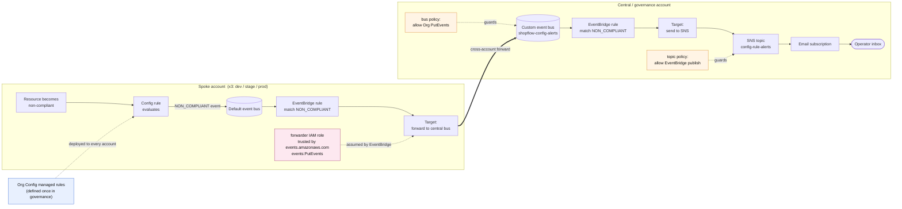

# Design Pattern: Centralized AWS Config Compliance Alerting

**Status:** reference design pattern
**Scope:** multi-account AWS Organization (Control Tower), one central governance account + N workload (spoke) accounts.

## Problem
AWS Config evaluates resources **in each account**, and the resulting compliance events fire on **that account's default EventBridge bus** — not centrally. We want a **single, central notification** whenever any resource in any workload account becomes `NON_COMPLIANT`, without standing up a notification stack in every account.

## Pattern
Deploy the compliance **rules** org-wide from the governance account, then **forward** each spoke's `NON_COMPLIANT` events, bus-to-bus, into **one central event bus**, which routes them to **one SNS topic** for notification.

## End-to-end flow
1. An org Config **rule** (deployed from governance to every account) marks a resource `NON_COMPLIANT`.
2. Config emits a `Config Rules Compliance Change` event onto the **spoke's default event bus**.
3. A spoke **EventBridge rule** matches `NON_COMPLIANT`.
4. Its **target** forwards the event to the **central custom bus** — using the **forwarder IAM role** (cross-account delivery requires a role).
5. The central bus's **resource policy** admits the event (sender is in the Org).
6. A **central rule** matches it and its **target** sends it to the **SNS topic** (allowed by the topic policy).
7. The topic's **email subscription** delivers the alert.

## Components
| Component | Where | Why it exists |
|---|---|---|
| Config org managed rules | Governance (fan out to all accounts) | Define what "non-compliant" means; generate the signal |
| Default event bus | Every spoke | Where AWS services (Config) auto-deliver events |
| Spoke EventBridge rule | Each spoke | Match only `NON_COMPLIANT` events |
| Forwarder IAM role | Each spoke | Lets EventBridge deliver cross-account (`events:PutEvents`) |
| Spoke target → central bus | Each spoke | The cross-account forward itself |
| Custom event bus | Central | Dedicated landing bus for all spokes' forwarded events |
| Event bus policy | Central | Allow Org accounts to `PutEvents` onto the bus |
| Central EventBridge rule | Central | Match the forwarded `NON_COMPLIANT` events |
| Central target → SNS | Central | Route matched events to the notification channel |
| SNS topic + topic policy | Central | The channel; policy lets EventBridge publish |
| SNS subscription | Central | The endpoint (email) that receives the alert |

## The two roles (commonly confused)
| | Spoke **deploy** role | **Forwarder** role |
|---|---|---|
| When | Deploy time (`terraform apply`) | Runtime (when an event fires) |
| Assumed by | Terraform (your identity) | EventBridge service |
| Purpose | Create resources in the spoke account | Allowed to deliver an event cross-account |
| Scope | Provisioning permissions | `events:PutEvents` to the central bus only |

## Three permission gates (one per boundary)
1. **Forwarder role policy** (spoke) — permission to send *out*.
2. **Event bus policy** (central) — permission to receive *in* (scoped to the Org).
3. **SNS topic policy** (central) — permission for EventBridge to *publish*.

## Why centralized (vs per-account SNS)
- One notification channel and one subscription to manage, not N.
- One place that owns "what happens on non-compliance" (today: notify; later: ticket / auto-remediate).
- Org-scoped bus policy means **new workload accounts are covered automatically** once the spoke forwarder is deployed to them.

## Trade-offs / notes
- Compliance **events** are per-account; only the central **bus** is shared — hence the forwarding hop (the aggregator centralizes *data for viewing*, not events).
- The spoke forwarder is deployed to each account (provider aliases / a module per account); adding a new account means deploying the spoke module there.
- Notification only. Auto-remediation (e.g. SSM Automation) is a separate, later extension off the same events.
